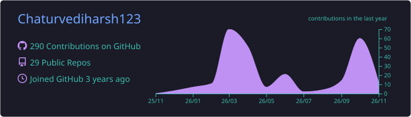
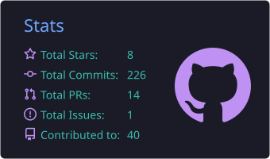
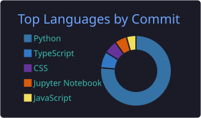

<div align="center">

# Hi, I'm Harsh Chaturvedi 👋

<a href="https://git.io/typing-svg">
  
</a>

<p>
  <a href="https://www.harshchaturvedi.me/"></a>
  <a href="https://www.linkedin.com/in/harsh-chaturvedi-537589292/"></a>
  <a href="mailto:chaturvediharsh123@gmail.com"></a>
  
</p>

</div>

---

## 🧠 About Me

```python
class Harsh:
    role       = "B.Tech Student — Artificial Intelligence"
    interests  = ["Machine Learning", "AI Agents", "LLMs", "RAG", "Automation"]
    building   = "AI-powered systems that solve real-world problems"
    approach   = "AI research + software engineering + automation"
    motto      = "Building intelligent systems that create real impact."
```

- 🎓 B.Tech student specializing in **Artificial Intelligence**
- 🤖 Passionate about **Machine Learning, AI Agents and Intelligent Systems**
- 🛠️ I combine **AI research, software engineering and automation** to build scalable systems
- 🌱 Currently going deep on **RAG, LLMs, agent architectures and conversational AI**

---

## 🛠️ Tech Stack

<table>
  <tr>
    <td align="center" width="170"><b>Languages</b></td>
    <td></td>
  </tr>
  <tr>
    <td align="center"><b>ML & AI</b></td>
    <td>
      
      
      
      
      
      
    </td>
  </tr>
  <tr>
    <td align="center"><b>LLMs & Agents</b></td>
    <td>
      
      
      
      
      
    </td>
  </tr>
  <tr>
    <td align="center"><b>Backend & APIs</b></td>
    <td>
      
      
      
    </td>
  </tr>
  <tr>
    <td align="center"><b>Automation</b></td>
    <td>
      
      
    </td>
  </tr>
  <tr>
    <td align="center"><b>Databases</b></td>
    <td></td>
  </tr>
  <tr>
    <td align="center"><b>Tools</b></td>
    <td></td>
  </tr>
</table>

---

## 🚀 Featured Projects

<!-- Replace each repository link with the real repo URL -->
<table>
  <tr>
    <td width="33%" valign="top">
      <h3>🎭 AI Emotion Detection</h3>
      <p>Machine-learning system that detects emotions from text using Natural Language Processing.</p>
      <p><code>Python</code> <code>NLP</code> <code>scikit-learn</code></p>
      <a href="https://github.com/chaturvediharsh123?tab=repositories">🔗 View repo</a>
    </td>
    <td width="33%" valign="top">
      <h3>🐰 Usagi AI</h3>
      <p>AI-powered intelligent assistant that helps users interact with systems efficiently.</p>
      <p><code>LLMs</code> <code>LangChain</code> <code>FastAPI</code></p>
      <a href="https://github.com/chaturvediharsh123?tab=repositories">🔗 View repo</a>
    </td>
    <td width="33%" valign="top">
      <h3>📞 AI Voice Agent</h3>
      <p>Multilingual conversational AI that automates citizen helpline systems.</p>
      <p><code>Voice AI</code> <code>Agents</code> <code>Multilingual</code></p>
      <a href="https://github.com/chaturvediharsh123?tab=repositories">🔗 View repo</a>
    </td>
  </tr>
</table>

---

## 📊 GitHub Stats

<!-- These cards are generated by .github/workflows/profile-assets.yml -->
<div align="center">







</div>

---

## 📈 Contribution Activity

<div align="center">
  
</div>

---

## 🐍 Contribution Snake

<div align="center">
  <picture>
    <source media="(prefers-color-scheme: dark)" srcset="https://raw.githubusercontent.com/chaturvediharsh123/chaturvediharsh123/output/github-snake-dark.svg"/>
    <source media="(prefers-color-scheme: light)" srcset="https://raw.githubusercontent.com/chaturvediharsh123/chaturvediharsh123/output/github-snake.svg"/>
    
  </picture>
</div>

---

## 🎯 Current Focus

| Area | What I'm exploring |
|---|---|
| 📚 **RAG** | Retrieval pipelines, chunking, embeddings, vector search |
| 🧠 **LLMs** | Fine-tuning, prompting, open-source models |
| 🤖 **AI Agents** | Multi-agent architectures, tool use, CrewAI / LangChain |
| 💬 **Conversational AI** | Voice agents and multilingual assistants |

---

<div align="center">

### 💡 *"Building intelligent systems that create real impact."*


</div>
